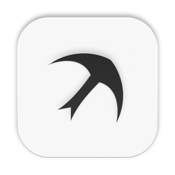
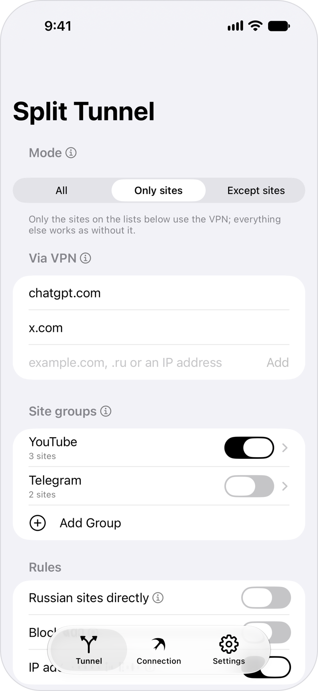
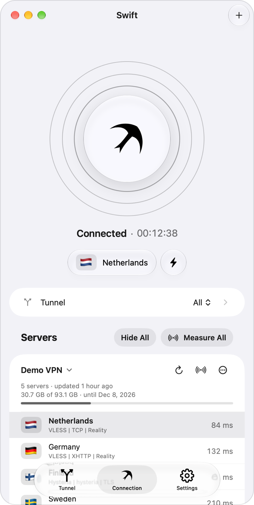
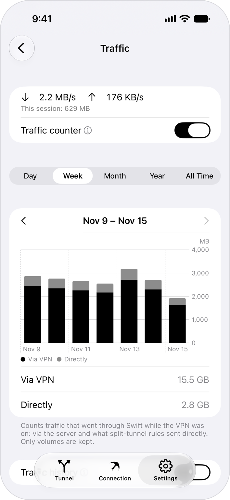

  <picture>
    <source media="(prefers-color-scheme: dark)" srcset="assets/icon-dark.png">
    
  </picture>

<h1 align="center">Swift</h1>

  A VPN client for Mac and iPhone. 
  The whole device — or just the sites and apps you pick — through the VPN in one tap.

  <a href="https://github.com/rystia/swift-vpn/releases/latest/download/Swift.dmg"><b>Download for Mac</b></a>
  &nbsp;&nbsp;·&nbsp;&nbsp;
  <a href="https://github.com/rystia/swift-vpn/releases/latest/download/Swift-iOS-unsigned.ipa"><b>Download for iPhone</b></a>
  &nbsp;&nbsp;·&nbsp;&nbsp;
  <a href="https://github.com/rystia/swift-vpn/releases">All releases</a>

  
  
  
  

 

  <picture>
    <source media="(prefers-color-scheme: dark)" srcset="assets/iphone-routing-dark.png">
    
  </picture>
  &nbsp;&nbsp;
  <picture>
    <source media="(prefers-color-scheme: dark)" srcset="assets/mac-dark.png">
    
  </picture>
  &nbsp;&nbsp;
  <picture>
    <source media="(prefers-color-scheme: dark)" srcset="assets/iphone-traffic-dark.png">
    
  </picture>

 

## Features

- **One tap.** Connect, disconnect and switch servers on the home screen. On Mac — also from the menu bar, on iPhone — from Control Center, the widget and Shortcuts.
- **The fastest server.** The lightning button next to the server measures them all and connects to the fastest one.
- **All the popular protocols.** VLESS (Reality, Vision, XHTTP, WebSocket, gRPC), VMess, Trojan, Shadowsocks, Hysteria 2, TUIC, WireGuard and SOCKS — powered by Xray and sing-box.
- **Subscriptions and keys.** Paste a subscription link or server keys, or scan a QR code on iPhone. Subscriptions update by themselves, and Swift shows the remaining traffic and the expiry date when your provider reports them.
- **Split tunneling.** Everything through the VPN, only the sites you pick, or everything except them. Sites, whole zones like .ru, IP addresses and subnets, plus ready-made sets: YouTube, Telegram, ChatGPT, WhatsApp, Signal, Gemini and more. On Mac — apps too.
- **Ad and tracker blocking** in every app at once.
- **Kill switch.** If the VPN drops, nothing goes to the internet around it until Swift reconnects.
- **Fragmentation** helps get past blocking.
- **Honest latency.** Each server is measured with a real request through it, not just the time to open a connection.
- **Traffic.** Live speed, session volume and a usage chart.
- **Native look.** Light and dark themes, a light or dark app icon, search in Settings, English and Russian.
- **On Mac** torrents can bypass the VPN, and `swiftvpn://connect`, `disconnect` and `toggle` links work from Shortcuts, Raycast or a hotkey.

## Install

### Mac

1. Download [Swift.dmg](https://github.com/rystia/swift-vpn/releases/latest/download/Swift.dmg) and drag Swift to Applications.
2. On first launch macOS says it can't verify the developer. Open System Settings → Privacy & Security and click **Open Anyway**.
3. Swift asks for your Mac password once to install a small system service. It creates the virtual network adapter that lets the VPN cover the whole Mac.
4. Paste a key or a subscription link and click the bird.

Requires an Apple Silicon Mac with macOS 26 or later.

### iPhone

1. Download [Swift-iOS-unsigned.ipa](https://github.com/rystia/swift-vpn/releases/latest/download/Swift-iOS-unsigned.ipa).
2. Sign it with your own developer certificate — in ESign, Feather, Sideloadly, zsign or a similar app. The provisioning profile needs **Network Extensions** (Packet Tunnel) and **App Groups**, and one profile signs the app and both of its extensions (the VPN and the widget).
3. Open Swift, allow it to add a VPN configuration, then paste a key or a subscription link.

Requires iOS 26 or later.

## Updates

On Mac, Swift checks for updates and installs them by itself. On iPhone, Swift checks for updates too: in Settings → Updates it downloads the new version and hands it to your signing app.

Every update is signed with an Ed25519 key, and Swift checks the signature and the file before installing, so a forged version won't get in even if someone tampers with the files.

## Security and privacy

- **No telemetry.** Swift collects no statistics. Besides your servers and subscriptions, it only contacts gstatic.com and cloudflare.com to measure latency and check the connection, a DNS server through the VPN (Cloudflare by default, or your own), and this page for updates.
- **Encrypted data.** Servers, keys and subscription links are stored encrypted (AES-GCM).
- **A strict service on Mac.** The system service only takes commands from the build of Swift you approved with your password, and checks every request.
- **Honest warnings.** Swift tells you when a subscription comes over plain http, a server has no encryption or its certificate checks are turned off.

## License

Swift is free. It bundles [sing-box](https://github.com/SagerNet/sing-box) (GPL-3.0) and [Xray-core](https://github.com/XTLS/Xray-core) (MPL-2.0) — their source code is available at those links.
