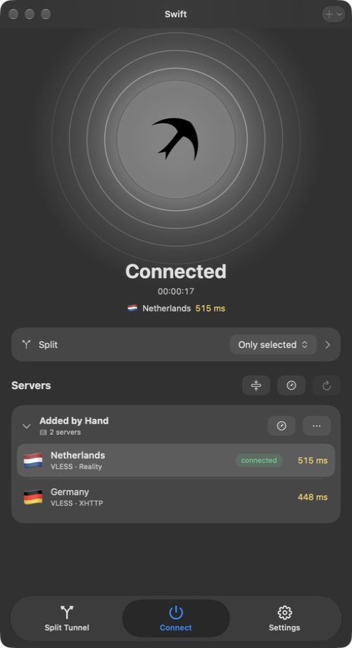

  <picture>
    <source media="(prefers-color-scheme: dark)" srcset="assets/icon-dark.png">
    
  </picture>

<h1 align="center">Swift</h1>

  A VPN client for Mac. 
  The whole Mac — or just the apps and sites you pick — through the VPN in one click.

  <a href="https://github.com/rystia/swift-vpn/releases/latest/download/Swift.dmg"><b>⬇︎ Download Swift for macOS</b></a>
  &nbsp;·&nbsp;
  <a href="https://github.com/rystia/swift-vpn/releases">All releases</a>

  
  
  
  

  &nbsp;
  &nbsp;
  

## Features

- **One button.** Connect, disconnect and switch servers on the home screen or right from the menu bar.
- **All the popular protocols.** VLESS (Reality, Vision, XHTTP, WebSocket, gRPC), VMess, Trojan, Shadowsocks, Hysteria 2, TUIC, WireGuard and SOCKS — powered by Xray and sing-box.
- **Subscriptions and keys.** Paste a subscription link or server keys from the clipboard (⇧⌘V). Subscriptions update by themselves, and Swift shows the remaining traffic and expiry date when your provider reports them.
- **Split tunneling.** Send the whole Mac through the VPN, only the apps and sites you pick, or everything except them. Sites, whole zones (.ru), IP addresses and subnets, plus ready-made sets: YouTube, Telegram, ChatGPT, Discord and more.
- **Ad and tracker blocking** in every app at once.
- **Kill switch.** If the VPN drops, nothing goes to the internet around it until Swift reconnects.
- **Torrents bypass the VPN** and **fragmentation** helps get past blocking.
- **Honest latency.** Each server is measured with a real request through it, not just the time to open a connection.
- **Traffic.** Live speed, session volume and a usage chart by day, week, month and year — with and without the VPN.
- **Link control** with `swiftvpn://connect`, `disconnect` and `toggle` — from Shortcuts, Raycast or a hotkey.
- Light and dark themes, window backgrounds, larger text, English and Russian.

## Install

1. Download [Swift.dmg](https://github.com/rystia/swift-vpn/releases/latest/download/Swift.dmg) and drag Swift to Applications.
2. On first launch macOS says it can't verify the developer. Open System Settings → Privacy & Security and click **Open Anyway**.
3. Swift asks for your Mac password once to install a small system service. It creates the virtual network adapter that lets the VPN cover the whole Mac.
4. Paste a key or a subscription link and click the bird.

From then on Swift checks for updates and installs them by itself.

**Requires** an Apple Silicon Mac with macOS 26 or later.

## Security and privacy

- **No telemetry.** Swift collects no statistics. It only talks to your servers and subscriptions, to gstatic.com to measure latency, and to this GitHub page for updates.
- **Encrypted data.** Servers, keys and subscription links are stored encrypted on disk (AES-GCM), with the key in the macOS keychain.
- **Signed updates.** Every update is signed with an Ed25519 key, so Swift won't install a forged version even if someone tampers with the files.
- **A strict service.** The system service only takes commands from the build of Swift you approved with your password, and checks every request.
- **Honest warnings.** Swift tells you when a subscription comes over plain http or a server has certificate checks turned off.

## License

Swift is free. It bundles [sing-box](https://github.com/SagerNet/sing-box) (GPL-3.0) and [Xray-core](https://github.com/XTLS/Xray-core) (MPL-2.0) — their source code is available at those links.
