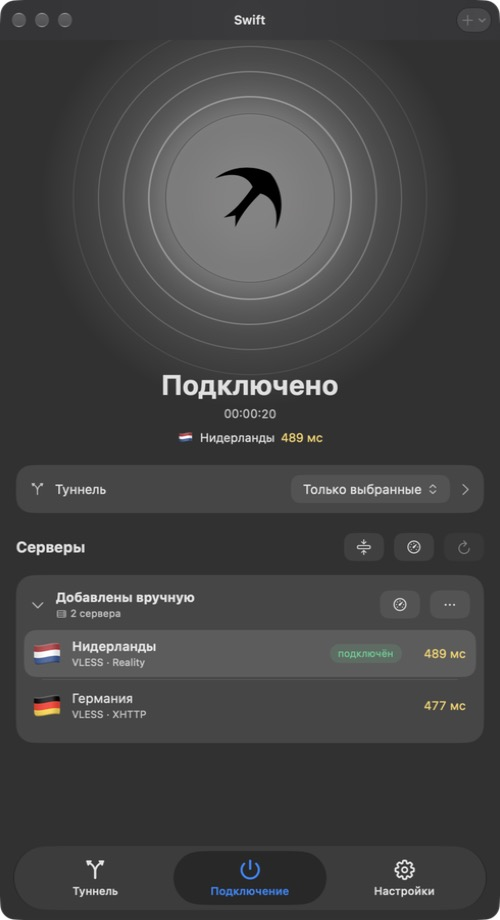
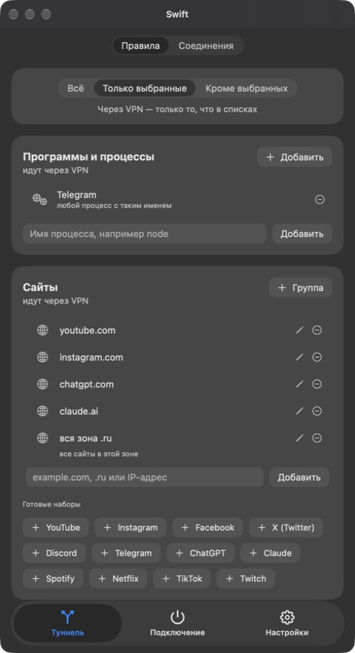
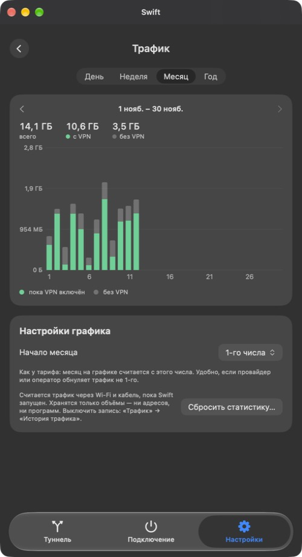

  <picture>
    <source media="(prefers-color-scheme: dark)" srcset="assets/icon-dark.png">
    
  </picture>

<h1 align="center">Swift</h1>

  VPN-клиент для Mac. 
  Весь Mac — или только нужные программы и сайты — через VPN в одно нажатие.

  <a href="https://github.com/vlasovrustam07-cpu/swift-vpn/releases/latest/download/Swift.dmg"><b>⬇︎ Скачать Swift для macOS</b></a>
  &nbsp;·&nbsp;
  <a href="https://github.com/vlasovrustam07-cpu/swift-vpn/releases">Все версии</a>

  
  
  
  

  &nbsp;
  &nbsp;
  

## Что умеет

- **Одна кнопка.** Подключиться, отключиться и сменить сервер — на главном экране или прямо из строки меню.
- **Все популярные протоколы.** VLESS (Reality, Vision, XHTTP, WebSocket, gRPC), VMess, Trojan, Shadowsocks, Hysteria 2, TUIC, WireGuard и SOCKS — на ядрах Xray и sing-box.
- **Подписки и ключи.** Вставьте ссылку на подписку или ключи из буфера (⇧⌘V). Подписки обновляются сами, а если провайдер сообщает остаток трафика и срок — Swift их покажет.
- **Раздельный туннель.** Через VPN — весь Mac, только выбранные программы и сайты или всё, кроме них. Сайты, целые зоны (.ru), IP-адреса и подсети, готовые наборы: YouTube, Telegram, ChatGPT, Discord и другие.
- **Блокировка рекламы и счётчиков** сразу во всех программах.
- **Kill switch.** Оборвался VPN — интернет мимо него не пойдёт, пока Swift не переподключится.
- **Торренты мимо VPN** и **фрагментация** для обхода блокировок.
- **Честный пинг.** Задержка меряется настоящим запросом через каждый сервер, а не только временем соединения.
- **Трафик.** Скорость, объём за сеанс и график по дням, неделям, месяцам и годам — с VPN и без него.
- **Управление ссылками** `swiftvpn://connect`, `disconnect`, `toggle` — из «Команд», Raycast или по горячей клавише.
- Светлая и тёмная тема, выбор фона, крупный текст, русский и английский язык.

## Установка

1. Скачайте [Swift.dmg](https://github.com/vlasovrustam07-cpu/swift-vpn/releases/latest/download/Swift.dmg) и перетащите Swift в «Программы».
2. При первом запуске macOS скажет, что не может проверить разработчика. Откройте «Системные настройки → Конфиденциальность и безопасность» и нажмите «Всё равно открыть».
3. Swift один раз попросит пароль от Mac — чтобы поставить небольшую системную службу. Она создаёт виртуальную сетевую карту, без которой VPN не включить для всего Mac.
4. Вставьте ключ или ссылку на подписку и нажмите на птицу.

Дальше Swift сам проверяет обновления и ставит их.

**Нужно:** Mac на Apple Silicon и macOS 26 или новее.

## Безопасность и приватность

- **Без телеметрии.** Swift не собирает статистику. В сеть он ходит только к вашим серверам и подпискам, к gstatic.com — для замера задержки — и сюда, на GitHub, за обновлениями.
- **Данные зашифрованы.** Серверы, ключи и ссылки на подписки лежат на диске в зашифрованном виде (AES-GCM), а ключ от них — в связке ключей macOS.
- **Подписанные обновления.** Каждое обновление подписано ключом Ed25519: поддельную версию Swift не поставит, даже если кто-то подменит файлы.
- **Строгая служба.** Системная служба выполняет команды только от той сборки Swift, которую вы одобрили паролем, и проверяет каждый запрос.
- **Предупреждения.** Swift честно скажет, если подписка идёт по http или у сервера отключена проверка сертификата.

## Лицензии

Swift бесплатный. Внутри работают [sing-box](https://github.com/SagerNet/sing-box) (GPL-3.0) и [Xray-core](https://github.com/XTLS/Xray-core) (MPL-2.0) — их исходный код открыт по ссылкам.

---

<b>English</b>

 

**Swift** is a VPN client for Mac: the whole Mac — or just the apps and sites you pick — through the VPN in one click.

- **One button** on the home screen or in the menu bar.
- **Protocols:** VLESS (Reality, Vision, XHTTP, WebSocket, gRPC), VMess, Trojan, Shadowsocks, Hysteria 2, TUIC, WireGuard and SOCKS — powered by Xray and sing-box.
- **Subscriptions and keys,** auto-updated, with the remaining traffic and expiry when your provider reports them.
- **Split tunneling** by apps, sites, zones and IP subnets, with ready-made sets.
- **Ad and tracker blocking,** **kill switch,** **torrents bypass,** **fragmentation.**
- **Real latency checks** through each server.
- **Traffic:** live speed, session volume and a usage chart by day, week, month and year.
- **`swiftvpn://` links** for Shortcuts and Raycast. Light and dark themes, Russian and English.

**Install:** download [Swift.dmg](https://github.com/vlasovrustam07-cpu/swift-vpn/releases/latest/download/Swift.dmg), drag Swift to Applications, allow it in System Settings → Privacy & Security on first launch, and enter your Mac password once to install the system service. Requires an Apple Silicon Mac with macOS 26 or later.

**Privacy:** no telemetry. Servers and subscriptions are encrypted at rest with a key in the macOS keychain, and updates are signed with Ed25519.

Bundled cores: [sing-box](https://github.com/SagerNet/sing-box) (GPL-3.0) and [Xray-core](https://github.com/XTLS/Xray-core) (MPL-2.0).

